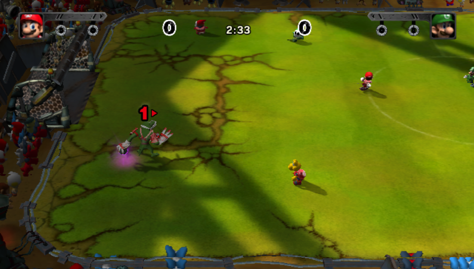

# Mario Strikers Charged for PS Vita

**Full-speed, native Mario Strikers Charged in your hands — now running smoothly at up to 60 fps with crisp dynamic resolution (up to native `960×544`), native `960×544` HUD & menus, and online and local multiplayer.**

This isn't emulation and it isn't streaming. The full Wii game has been rebuilt natively for the PlayStation Vita's processor and graphics chip, with Vita controls, touch support, crash-safe saves, in-game settings, and automatic artwork straight from your own disc.

**[Download Version 2.0.1](https://github.com/CBOC-Vita-Lab/strikers-charged-vita/releases/latest)** ·
[Easy Install](EASY-INSTALL.md) · [Manual Install](MANUAL-INSTALL.md) · [Controls](CONTROLS.md) · [Live Leaderboard](https://strikers.psvita.dev/leaderboard) · [Full Release Notes](CHANGELOG.md)

> Bring your own Wii USA (Rev 1) disc copy of *Mario Strikers Charged*. No Nintendo game data or artwork is bundled in this repository or VPK.

---

## What's New In Version 2.0.1

- **2–4 player same-console local multiplayer** on **PlayStation TV (PSTV)** and **handheld PS Vita** with extra paired Bluetooth controllers (e.g. `MiniVitaTV`), with **live hot-plugging and reconnection** — no restart needed.
- **DualShock 3 / DualShock 4 `L2`/`R2` triggers & per-player rumble** (`L2` = Cycle Item / Shakedown, `R2` = Chip & Run / Mega Save block, independent vibration per controller; handheld + `ds34vita` supported with no ghost Player 2).
- **100% Online & Local cross-compatible with 2.0** — update seamlessly over 2.0 without losing saves, settings, or matchmaking compatibility.

## Highlights — What's New In Version 2.0

Version 2.0 is the biggest leap since launch — transforming how the game looks, feels, and plays on PS Vita (and rolling in every improvement from the withdrawn 1.2 preview).

### Smooth 60 FPS & Crisp Dynamic Resolution
- **Smooth 60 fps right out of the box.** **SMOOTH 60** is now the default: matches run cleanly at **60 frames per second** with dynamic 3D resolution that scales up to full native **`960×544`** whenever GPU headroom allows, while keeping the **2D HUD, menus, Title screen, and Mega Saves locked at full native `960×544`**.
- **Seamless automatic pacing & locked 30 option.** When the stadium gets truly wild, the game steps down gracefully (`60 → 45 → 30`) instead of stuttering — and climbs right back to 60 fps the moment the action clears. Prefer max sharpness everywhere? Switch to **30 LOCKED** anytime in **VITA SETTINGS** for locked 30 fps at **full native `960×544` with `2× MSAA`**.
- **Built for speed.** Deep engine, graphics, and compiler optimizations squeeze maximum performance from the Vita while automatically setting optimal clocks during play.

### First-Ever Online & Local Multiplayer on PS Vita *(Beta)*
- **Play friends anywhere with a room code.** Host a private match in seconds and share a short invite code, or jump straight into public matchmaking with **PLAY WITH ANYONE** (unranked) and **RANKED MATCH** (with season and daily leaderboards — view the live web leaderboard anytime at **[strikers.psvita.dev/leaderboard](https://strikers.psvita.dev/leaderboard)**).
- **Face-to-face local play.** Challenge another Vita next to you with **Same Wi-Fi** or **Nearby** local multiplayer.
- **Built for real-world play.** Clear connection status, live partner wait feedback, instant disconnect handling, and built-in **REPORT A PROBLEM** and **ONLINE ACCOUNT** tools right in the Multiplayer menu. *(Multiplayer is marked **Beta** while two-Vita testing continues — update both Vitas to 2.0 to connect.)*

### Stutter-Free Play From Your Very First Kickoff
- **Complete full-game shader pack included.** Over **4,200 graphics shaders** prebuilt on a real PS Vita across all 17 stadiums, 12 captains, 11 power-ups, menus, replays, Mega Strikes, and Mega Saves — virtually eliminating first-time shader freezes mid-match while keeping boot warm-up fast (~1.2 seconds).
- **Razor-sharp Mega Strikes & Mega Saves.** Mega Strikes hold steady without mid-scene blur or resolution bounces, and Mega Save gloves, balls, and the Title screen stay crisp at full native resolution.
- **Big stadium upgrades.** **Pipeline Central** and **The Dump** got dedicated graphics and performance passes — fixing rain/shadow flicker, kickoff hitches, and heavy reflective floors so every stadium plays great.

### Polished, One-App Handheld Experience
- **One VPK, redesigned in-game VITA SETTINGS.** Pause any match and choose **VITA SETTINGS**, or open **OPTIONS > VITA SETTINGS** on the main menu — five clean pages with clear descriptions, one-tap reset, and no separate Settings app or extra LiveArea tile. *(Hold **L + R** on launch for **Safe Start** if needed.)*
- **Automatic artwork from your own disc.** On first launch, the game automatically creates its own *Mario Strikers Charged* loading screen, LiveArea background, START gate, launch splash, and circular Home bubble right on your Vita from your disc files — with zero game artwork bundled in the download and without overwriting custom icons. *(LiveArea and loading screen update right away; on manual VPK installs, reboot your Vita once to refresh the Home bubble — or use CBOC Vita Installer to brand it before install.)*
- **English, Español & Français.** Pick your language in **VITA SETTINGS** and both the game's North American text and every Vita menu, guide, loading screen, and online screen switch automatically.
- **Rock-solid saves, audio & stability.** Crash-safe atomic saves with automatic backup, cleaner audio recovery after sleep/resume, software fallback if a video stalls, and dozens of crash and progression fixes (Unlock All now defaults to OFF, and every locked stadium unlocks cleanly).

See the [full Version 2.0 changelog](CHANGELOG.md) for the complete breakdown, including everything from 1.1.

## What To Expect

| | |
|---|---|
| **Matches** | Smooth **60 fps** with crisp dynamic resolution (up to native **960×544** when headroom allows, native **960×544** HUD; **30 LOCKED** runs full native **960×544 + 2× MSAA**) |
| **Multiplayer *(Beta)*** | First-ever **Online** (Friend Room Codes, Quick Play, Ranked [Leaderboard](https://strikers.psvita.dev/leaderboard)) and **Local** (Same Wi-Fi & Nearby) play on PS Vita |
| **Mega Strikes & Mega Saves** | Smooth, steady Mega Strikes with zero mid-scene resolution jumps; Mega Save gloves and balls sharp at full **960×544** |
| **Loading & Stutters** | 4,281 prebuilt Vita shaders included (~1.2 s warm-up), virtually eliminating mid-match shader compile freezes |
| **Controls** | Snappy Modern & Classic layouts, 2–4P same-console PS TV / external controllers with DualShock 3/4 `L2`/`R2`, rumble & hot-plug, tuned Mega Save aiming, plus optional touch and rear-touch support |
| **Artwork & Languages** | Auto-generated loading screen, LiveArea & Home bubble from your own disc; full English, Spanish, and French UI |
| **Saves & Updates** | Crash-safe atomic saves with backup; updates cleanly right over 1.0/1.1 without touching your saves or game files |

Prefer a locked 30 fps? Pause a match and pick **VITA SETTINGS** (or **OPTIONS > VITA SETTINGS** in the main menu) and set **Frame Rate** to **30 LOCKED**; the default is **SMOOTH 60**. A few minor items are still being worked on — see [Known Issues](KNOWN-ISSUES.md).

## Recommended Plug-ins For Best 60 FPS Performance *(Optional)*

The game runs great on a stock homebrew Vita with no extra plug-ins — it already requests the Vita's highest built-in clocks automatically (`444 MHz` CPU / `222 MHz` GPU & bus). However, for the **smoothest 60 fps experience** (especially in heavy stadiums like The Dump and Pipeline Central), we strongly recommend two popular open-source Vita plug-ins:

- **Overclocking — [PSVshell](https://github.com/Electry/PSVshell) / [PSVshellPlus](https://github.com/GrapheneCt/PSVshellPlus) (`500 MHz` CPU):** Unlocks the PS Vita's full **500 MHz CPU** (alongside **222 MHz GPU**, **222 MHz BUS**, and **166 MHz XBAR**). Version 2.0 automatically detects your overclock profile and leaves it untouched.
- **4th CPU Core — [CapUnlocker](https://github.com/GrapheneCt/CapUnlocker):** Unlocks the Vita's 4th system CPU core for games. Version 2.0 **detects and uses it automatically** (no config edits needed!) to offload audio and background tasks for extra 60 fps headroom, and safely falls back to 3 cores if the plug-in isn't installed.

*Plug-ins are completely optional and never bundled in the VPK. See [Optional Plug-ins](docs/PLUGINS.md) for install notes and safety tips.*

## Install

You need:

- a Vita with homebrew enabled and VitaShell;
- your own **Mario Strikers Charged, Wii, USA (Rev 1)** disc, as an ISO, RVZ
  or extracted folder;
- the Vita's shader compiler module, `libshacccg.suprx` (most homebrew-ready
  Vitas already have it);
- about 3 GB of free space.

### Easy way: CBOC Vita Installer

[CBOC Vita Installer](https://github.com/CBOC-Vita-Lab/vita-installer/releases/latest)
does everything for you on Windows, Mac or Linux. Open it, press SELECT in
VitaShell, click **Get** next to Mario Strikers Charged, choose your disc and
click **Install**. [Step-by-step guide](EASY-INSTALL.md).

### Manual way

1. Download **[Strikers-Charged-Vita.vpk](https://github.com/CBOC-Vita-Lab/strikers-charged-vita/releases/latest/download/Strikers-Charged-Vita.vpk)**.
2. Extract your disc with Dolphin to get its `sys` and `files` folders
   ([how](MANUAL-PREPARE-GAME.md)).
3. Copy `sys` and `files` to `ux0:data/mscharged/game/` on the Vita, and the
   VPK to `ux0:VPK/`.
4. Install the VPK in VitaShell and launch the bubble.

The [full install guide](MANUAL-INSTALL.md) covers USB, FTP and memory card transfers
and what to do if something doesn't start.

**Updating from an earlier version?** Just install the new VPK over the old
one. Your game files, saves and settings stay put.

## Playing

The default **Modern** layout:

- **Cross** passes, or switches player on defence.
- **Circle** shoots (hold to charge), or slide-tackles.
- **Square** lobs, or lays on a big hit.
- **Triangle** uses your item.

Prefer the original feel? Switch to **Classic** in Settings. Mega Saves work
with touch or either stick.

Pause a match and pick **VITA SETTINGS** (it takes the place of the Wii controller
map; not in an online or LAN match), or open **OPTIONS** in the main menu and pick **VITA SETTINGS** in the bottom corner, to change
controls, picture and performance options, then jump straight back into your
match. **Language** (English, Spanish or French) is on the first page. Camera
zoom is in the game's own Options > Visual.
[All controls](CONTROLS.md).

## Download Contents

| File | What it is |
|---|---|
| `Strikers-Charged-Vita.vpk` | The game. This is all most people need. |
| `Strikers-Charged-Vita-install.zip` | The VPK plus guides, checksums and full source |

## For Developers

The full source is here and builds with VitaSDK.

| | |
|---|---|
| [Building](docs/BUILDING.md) | Toolchain, dependencies, build and packaging |
| [Technical notes](docs/TECHNICAL.md) | How the port and renderer work, settings |
| [Diagnostics](docs/DIAGNOSTICS.md) | Logs and performance tools |
| [Source record](docs/SOURCE.md) | What each release was built from |

`native/` holds the game code and Vita platform layer, `renderer/` the
graphics translation layer, and `dependencies/vitaGL/` our patched vitaGL.

## What A Problem Report Contains

VITA SETTINGS > ONLINE ACCOUNT > SEND A REPORT (or REPORT A PROBLEM in the Multiplayer menu, or the offer after a game that went wrong) sends one report to the online service, only
when you press SEND on the screen that lists it. It holds:

- your online name (the one on the rankings);
- the last lines of the game's multiplayer log (about 8 KiB), your last connection check, and the multiplayer events of this run;
- anonymous numbers from your last online game: how long it lasted, the input delay, reconnects, packet loss, whether it ended with an error;
- what kind of game it was (online, Same Wi-Fi or Nearby; ranked, quick or a friend's room), how far it got (sign-in, queue, match found, connecting, the match, the result
  upload), the errors on the way, counts of the online requests and connections, whether the two Vitas got out of step (and at which step), the longest wait for the other
  player, and whether the other Vita had the same game version;
- the game version and build.

Without an online account on the Vita (Nearby or Same Wi-Fi only) a report cannot be sent; it is saved as `ux0:data/mscharged/mp-report.txt` instead, so you can attach it to a
message.

IP addresses, MAC addresses, account ids, tokens, invite codes and your friend list are never in it: the game removes anything that looks like one before sending, and the
service removes it again when it arrives. A report is at most 48 KB, you can send 3 a day, and the service deletes it after 30 days. VITA SETTINGS > ONLINE ACCOUNT > DELETE MY ONLINE
ACCOUNT removes your name, friends, invitations and reports from the service at once. Online games also leave the same anonymous numbers (no name, no address) at the end of a
session so the owner can see how often games end badly; nothing else about you is kept with them. Single player and LAN play send nothing.

## Credits

Built by AI coding agents (Claude, with help from other assistants), directed
and play-tested on real hardware by a human. It stands on the shoulders of the
[mscharged-decomp](https://github.com/yannicksuter/mscharged-decomp)
decompilation, [vitaGL](https://github.com/Rinnegatamante/vitaGL), VitaSDK and
the other projects in [Credits](CREDITS.md) and the
[third-party notices](THIRD_PARTY_NOTICES.md).

This is an unofficial fan project, not affiliated with or endorsed by Nintendo
or Sony. Mario Strikers Charged is © Nintendo.
