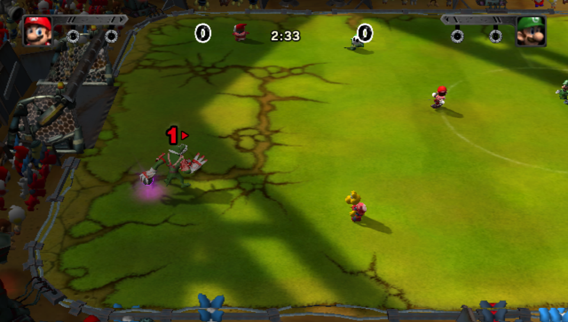

# Mario Strikers Charged for PS Vita

**Mario Strikers Charged, running natively on your PS Vita.** No emulator, no
streaming, no compromises on the parts that matter: the hard-hitting
five-a-side football, the electric stadiums, the Mega Strikes and the
trash-talking captains, all in your hands.

This isn't the Wii game squeezed through an emulator. The game's own code has
been rebuilt for the Vita's processor, with a renderer written from scratch for
the Vita's graphics chip. Controls, touch, sound, saves and settings are all
built for the handheld.

**[Download the latest version](https://github.com/CBOC-Vita-Lab/strikers-charged-vita/releases/latest)** ·
[Install guide](INSTALL.md) · [Controls](CONTROLS.md) · [What's new](CHANGELOG.md)

You'll need your own copy of the game. No game data is included.

## New In Version 1.1

This is the big performance update, and the game feels like a different port
for it.

- **Up to 60 fps.** The game now runs at 60 frames per second whenever the
  Vita can keep up, and holds a smooth 30 when the action gets heavy. You
  don't have to do anything: it's automatic.
- **Snappier controls.** The delay between pressing a button and seeing it on
  screen is down by a third, to about a tenth of a second in normal play.
- **Mega Strikes look great and play smoothly.** The glowing haze is drawn at
  a lower resolution and blended over a full-resolution scene, so the players,
  ball and stadium stay sharp while the scene runs at a steady 30 fps.
  The previous version dropped to about 15 fps here.
- **Mega Saves feel responsive again.** Stick and touch input reach the game
  sooner, so blocking a Mega Strike is about reflexes, not guessing.
- **Sharper picture everywhere.** A light sharpening filter is on by default,
  it smooths jagged character outlines, and when the Vita has room to spare
  the game draws above native resolution for cleaner edges.
- **Optional HD characters.** Turn your own game files into sharper faces,
  kits and a sharper ball for Mega Strikes, celebrations and menus, with no
  cost to frame rate. [How](tools/hdtex/README.md).
- **Resolution that adapts.** When the graphics chip is stretched, the game
  softens effects first and the scene only slightly, so the frame rate holds
  without the picture falling apart. Changes happen at camera cuts, so you
  won't feel them mid-play.
- **Tap anywhere to start** on the title screen.
- **All seven camera zoom levels** on the Options slider, and the CPU plays
  just as smart when you zoom in close.
- **More reliable touch and buttons.** Quick taps are no longer missed, and
  button presses are never lost or repeated.

Want the fine print? See the [full list of changes](CHANGELOG.md).

## What To Expect

| | |
|---|---|
| **Matches** | A smooth 30 fps in open play, up to 60 when the scene is light |
| **Mega Strikes and Mega Saves** | Steady 30 fps at full resolution |
| **Goal replays and celebrations** | Around 20-25 fps for now |
| **Menus** | Mostly 30 fps; the main menu and the team and stadium screens run in the low 20s |
| **Controls** | About a tenth of a second from button to screen in normal play |
| **Picture** | Native Vita resolution or higher, lightly sharpened |
| **Saves** | Your saves and settings carry over between updates |

Prefer a locked 30? Open **Settings** from the LiveArea and set **Frame Rate**
to **30 FPS**. A few things are still being worked on: see
[Known Issues](KNOWN-ISSUES.md).

## Install

You need:

- a Vita with homebrew enabled and VitaShell;
- your own **Mario Strikers Charged, Wii, USA (Rev 1)** disc, as an ISO, RVZ
  or extracted folder;
- the Vita's shader compiler module, `libshacccg.suprx` (most homebrew-ready
  Vitas already have it);
- about 3 GB of free space.

### Easy way: CBOC Vita Installer

[CBOC Vita Installer](https://github.com/CBOC-Vita-Lab/vita-installer/releases/latest)
does everything for you on Windows, Mac or Linux. Open it, press SELECT in
VitaShell, click **Get** next to Mario Strikers Charged, choose your disc and
click **Install**. [Step-by-step guide](DESKTOP-INSTALL.md).

### Manual way

1. Download **[Strikers-Charged-Vita.vpk](https://github.com/CBOC-Vita-Lab/strikers-charged-vita/releases/latest/download/Strikers-Charged-Vita.vpk)**.
2. Extract your disc with Dolphin to get its `sys` and `files` folders
   ([how](PREPARE-GAME.md)).
3. Copy `sys` and `files` to `ux0:data/mscharged/game/` on the Vita, and the
   VPK to `ux0:VPK/`.
4. Install the VPK in VitaShell and launch the bubble.

The [full install guide](INSTALL.md) covers USB, FTP and memory card transfers
and what to do if something doesn't start.

**Updating from an earlier version?** Just install the new VPK over the old
one. Your game files, saves and settings stay put.

## Playing

The default **Modern** layout:

- **Cross** passes, or switches player on defence.
- **Circle** shoots (hold to charge), or slide-tackles.
- **Square** lobs, or lays on a big hit.
- **Triangle** uses your item.

Prefer the original feel? Switch to **Classic** in Settings. Mega Saves work
with touch or either stick.

Press **PS** during play and tap **Settings** in the LiveArea to change
controls, picture and performance options, then jump straight back into your
match. Camera zoom is in the game's own Options > Visual.
[All controls](CONTROLS.md).

## Download Contents

| File | What it is |
|---|---|
| `Strikers-Charged-Vita.vpk` | The game. This is all most people need. |
| `Strikers-Charged-Vita-install.zip` | The VPK plus guides, checksums and full source |

## For Developers

The full source is here and builds with VitaSDK.

| | |
|---|---|
| [Building](docs/BUILDING.md) | Toolchain, dependencies, build and packaging |
| [Technical notes](docs/TECHNICAL.md) | How the port and renderer work, settings |
| [Diagnostics](docs/DIAGNOSTICS.md) | Logs and performance tools |
| [Source record](docs/SOURCE.md) | What each release was built from |

`native/` holds the game code and Vita platform layer, `renderer/` the
graphics translation layer, and `dependencies/vitaGL/` our patched vitaGL.

## Credits

Built by AI coding agents (Claude, with help from other assistants), directed
and play-tested on real hardware by a human. It stands on the shoulders of the
[mscharged-decomp](https://github.com/yannicksuter/mscharged-decomp)
decompilation, [vitaGL](https://github.com/Rinnegatamante/vitaGL), VitaSDK and
the other projects in [Credits](CREDITS.md) and the
[third-party notices](THIRD_PARTY_NOTICES.md).

This is an unofficial fan project, not affiliated with or endorsed by Nintendo
or Sony. Mario Strikers Charged is © Nintendo.
