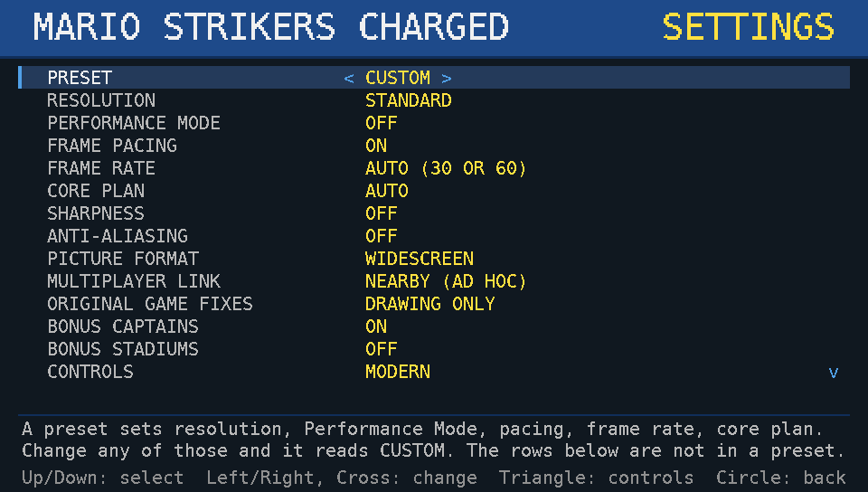

# Screenshots

Existing physical-Vita captures from 2026-10-19, selected for the store listing.
These are unchanged images, not new tests, emulator captures or generated art.

## Gameplay

Mario versus Luigi at The Vice after returning from the settings overlay.
Captured on the isolated diagnostic application `CDXMV0001` during the settings
update. It illustrates gameplay but is not a screenshot of a newly installed
public VPK and does not establish a sustained frame rate.

SHA-256: `0b9af8ceb19060ac1922ccbb80689570f3d34d057906c3e04ff427369cead6b9`

## Settings

Captured on the normal-title `MSCN00003` quiet runtime after its verified
executable-only update. That runtime's SHA-256 is
`0243f69693d1fc72b0629558c68d6eac990ca7a39d29f2c84c6f3d56ce7143a4`,
matching the selected public VPK. This was not a full VPK installation test.

SHA-256: `bd53b2dd4b297daba20254ab4636ce5034f030c22d172638b6a45257a50b9c2d`

## Privacy And Scope

Both PNGs are 960 x 544. Visible content was checked for account names, device
addresses, private artwork and desktop UI. Embedded metadata contains only
color-space and pixel-dimension fields, with no identifying text or location.
No source captures were altered. Game imagery remains the property of its
respective owners; these illustrations are not a game-data or artwork pack.
